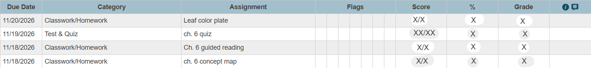

# Fantasy Grades
Ever fantasized about having that dream grade? Meet Fantasy Grades, a remake of my first-ever solo website! This new grade calculator is adaptive to all weights, potential grade situations, and has some extra features sprinkled in.

## About
Hi! It's me, the developer. A fun fact about me is that I go (or went if this is people from the future) to high school. How fun!
Another fun fact is that I like having good grades (The Ind-fluence finally caught up to me! /j )
As such, I always wonder (and end up asking AI) to calculate my grades if I turned a homework in on time or if this test was a 95 instead of an 75 (i still to this day have no idea what electrons in the ETC are used for lol).
That is the goal of Fantasy Grades - a place where you can ask anything about your grades.

## Features

### So Far
- Absolutely nothing.

### Planned
- Grade Calculator that calculates grade like PowerSchool
- Grid to Calculate Grades (Example Screenshot Below)
- Prompt for AI to make study guides
- QOL features that my old website didn't have (light/dark mode, auto saving to localStorage, visuals)
- Special Cases (Finals, Dropped Grades)
- Goal Grades and What If scenarios ("yoo gpt here are my grades can i get a 90 for the marking period" "nah twin u cooked")

## Languages Used
I will forever be an HTML/CSS/JS ~~prisoner~~ warrior!

## Screenies

(Example Grid of What End Grid Will Look Like (Grades Blurred for Privacy))